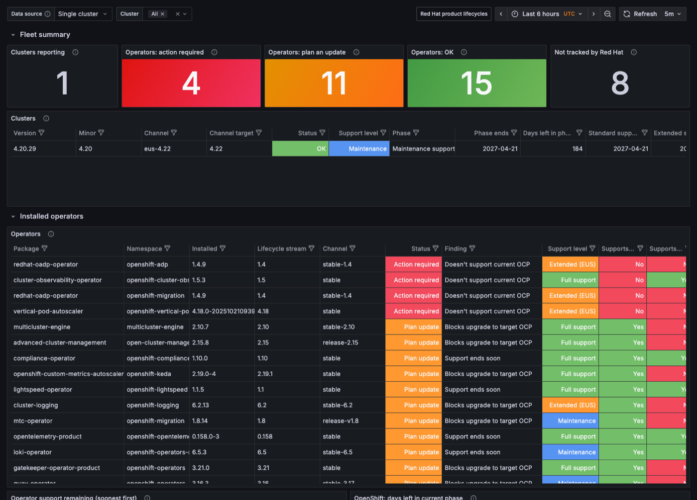

# ocp-lifecycle-dashboard

For each OpenShift cluster, this shows whether its OpenShift version and every
installed operator are still supported by Red Hat. It also shows whether those
operators support the OpenShift version your update channel is heading to.



A small exporter on each cluster does the work:

- Every 4 hours it reads Red Hat's [Product Life Cycle](https://access.redhat.com/product-life-cycles) API.
- Every 10 minutes it reads the cluster's ClusterVersion, operator Subscriptions and CSVs.
- It joins the two and publishes the results as Prometheus metrics (`ocp_lifecycle_*`).

You choose how those metrics reach Grafana. There are three ready-made options.

```
                 ┌─────────── each OpenShift cluster ───────────┐
 access.redhat ──▶ ocp-lifecycle-exporter  (:9120/metrics)       │
                 │        │                                      │
                 │        ├─ 1. OpenShift Prometheus ────────────┼──▶ Grafana (Thanos Querier, or remote-write store)
                 │        ├─ 2. OpenTelemetry collector ─────────┼──▶ Grafana (any OTLP / remote-write backend)
                 │        └─ 3. OpenShift Prometheus ── ACM ─────┼──▶ ACM hub Grafana (+ any Grafana on the hub's Thanos)
                 └───────────────────────────────────────────────┘
```

## Choosing an option

| | **1. OpenShift monitoring** | **2. Red Hat build of OpenTelemetry** | **3. Red Hat ACM** |
|---|---|---|---|
| Best for | One cluster or a few, and you already use OpenShift monitoring | You already send metrics through OpenTelemetry to a central backend | A fleet managed by ACM |
| Collects with | User workload monitoring (default) or platform Prometheus | An `OpenTelemetryCollector` that scrapes the exporter | Platform Prometheus, forwarded to the hub by ACM observability |
| Installs with | `oc apply -k` on each cluster | `oc apply -k` on each cluster | One ACM Policy on the hub, rolled out to every selected cluster |
| You need | User workload monitoring enabled, or nothing if you use the platform variant | The Red Hat build of OpenTelemetry operator and a metrics backend | ACM, with MultiClusterObservability enabled for the dashboard |
| Grafana | In-cluster (Grafana Operator) or external, on Thanos Querier or a remote-write store | In-cluster or external, on your backend | ACM's built-in Grafana, ready to use, or your own Grafana on the hub's Thanos |
| Multi-cluster view | Remote-write each cluster to one store | Built in: each collector labels its cluster | Built in |
| Alerts | Yes, through OpenShift alerting | Not included: load the rules into your backend | Yes, forwarded to the hub's Alertmanager |

Each option is a directory under [`deploy/`](deploy). All of them share the
same exporter manifests ([`deploy/base`](deploy/base)) and the same dashboard
([`dashboards/ocp-lifecycle.json`](dashboards/ocp-lifecycle.json)).

### Requirements for every option

- OpenShift 4 with operators installed through OLM (Subscriptions).
- Egress from the exporter pod to `access.redhat.com`. Behind a proxy, add
  `HTTPS_PROXY` and `NO_PROXY` to the Deployment.
- The ability to pull `quay.io/rh_ee_ssnyder/ocp-lifecycle-dashboard`, or a copy
  in your own registry (see [Image](#image)).

## Option 1: OpenShift monitoring

The cluster's own Prometheus scrapes the exporter. The default is user
workload monitoring, which is Red Hat's supported path for workloads you add
yourself.

1. Enable user workload monitoring if it isn't already, by setting
   `enableUserWorkload: true` in `openshift-monitoring/cluster-monitoring-config`.
   See the [OpenShift docs](https://docs.redhat.com/en/documentation/openshift_container_platform/latest/html/monitoring/configuring-user-workload-monitoring).
   To use the platform Prometheus instead, change the component in
   [`deploy/option-1-openshift-monitoring/kustomization.yaml`](deploy/option-1-openshift-monitoring/kustomization.yaml)
   to `../components/platform-monitoring`.
2. Deploy the exporter, its ServiceMonitor and its alerts:
   ```sh
   oc apply -k deploy/option-1-openshift-monitoring
   ```
3. Check it. The metric should return results in the console under
   **Observe → Metrics** within a few minutes:
   ```sh
   oc -n ocp-lifecycle get pods
   # then query: ocp_lifecycle_operator_status
   ```
4. Connect Grafana. Pick whichever case fits:

   **Grafana in the same cluster, managed by the Grafana Operator.**
   1. In [`grafana-operator/kustomization.yaml`](deploy/option-1-openshift-monitoring/grafana-operator/kustomization.yaml),
      set `namespace` to your Grafana's namespace and fix `instanceSelector` to match your `Grafana` CR.
   2. Apply it:
      ```sh
      oc apply -k deploy/option-1-openshift-monitoring/grafana-operator
      ```
      This creates a read-only service account, a data source on Thanos Querier
      (verified with the service CA) and the dashboard.

   **Any other Grafana (outside the cluster, or not managed by the operator).**
   1. Create a read-only token:
      ```sh
      oc apply -k deploy/option-1-openshift-monitoring/grafana-reader
      oc -n ocp-lifecycle extract secret/ocp-lifecycle-grafana-token --keys=token --to=-
      oc -n openshift-monitoring get route thanos-querier -o jsonpath='{.spec.host}'
      ```
   2. Add a Prometheus data source with URL `https://<that host>` and a custom
      HTTP header `Authorization: Bearer <token>`.
   3. Import [`dashboards/ocp-lifecycle.json`](dashboards/ocp-lifecycle.json)
      (**Dashboards → New → Import**).

   **Many clusters in one Grafana.** Have each cluster's Prometheus
   remote-write only the `ocp_lifecycle_*` series, with a `cluster` external
   label, to one shared store: Prometheus, Thanos Receive, Mimir or similar.
   Merge the example matching your monitoring stack into your existing ConfigMap:
   - [`remote-write/user-workload-monitoring-config.example.yaml`](deploy/option-1-openshift-monitoring/remote-write/user-workload-monitoring-config.example.yaml)
   - [`remote-write/cluster-monitoring-config.example.yaml`](deploy/option-1-openshift-monitoring/remote-write/cluster-monitoring-config.example.yaml)

   Then point Grafana at the store.

With one cluster and no `cluster` label, the dashboard still works: the
Cluster selector stays on **All**.

## Option 2: Red Hat build of OpenTelemetry

An OpenTelemetry collector in the `ocp-lifecycle` namespace scrapes the
exporter and pushes the metrics to your backend. It adds a `cluster` label as
it does so. OpenShift monitoring isn't involved.

1. Install the **Red Hat build of OpenTelemetry** operator from OperatorHub.
2. Edit [`deploy/option-2-opentelemetry/opentelemetry-collector.yaml`](deploy/option-2-opentelemetry/opentelemetry-collector.yaml)
   at the two `CHANGE ME` lines:
   - **`cluster`:** a unique name for this cluster.
   - **The exporter endpoint:** your backend's address, plus any auth header or tenant header.

   It uses OTLP/HTTP, which Prometheus 3 (with `--web.enable-otlp-receiver`;
   endpoint `http://<prometheus>:9090/api/v1/otlp`), Mimir, Thanos Receive and
   Grafana Cloud all accept. A `prometheusremotewrite` exporter is included,
   commented out. Check the Red Hat build of OpenTelemetry release notes for the
   support level of the `prometheus` receiver and the exporter you choose.
3. Deploy:
   ```sh
   oc apply -k deploy/option-2-opentelemetry
   ```
4. Connect Grafana to your backend:
   - **Grafana Operator:** set the URL in
     [`grafana-operator/datasource.yaml`](deploy/option-2-opentelemetry/grafana-operator/datasource.yaml)
     and the namespace and selector in its `kustomization.yaml`, then run
     `oc apply -k deploy/option-2-opentelemetry/grafana-operator`.
   - **Any other Grafana:** add a Prometheus data source for the backend and
     import [`dashboards/ocp-lifecycle.json`](dashboards/ocp-lifecycle.json).

Repeat steps 2 and 3 on every cluster with a different `cluster` value. The
metric names arrive unchanged (verified with Prometheus' OTLP receiver).

Alerts: [`deploy/components/alerts/prometheusrule.yaml`](deploy/components/alerts/prometheusrule.yaml)
holds the rule expressions. Load them into your backend's ruler if you want alerts.

## Option 3: Red Hat Advanced Cluster Management

Apply this once on the hub. It contains:

- **[`policy-platform-monitoring.yaml`](deploy/option-3-acm/policy-platform-monitoring.yaml):**
  an ACM Policy that installs the exporter, its ServiceMonitor and its alerts
  on every selected cluster. Delete the policy and they're removed again.
- **[`placement.yaml`](deploy/option-3-acm/placement.yaml):** the Placement
  that selects the clusters. By default that's every OpenShift cluster in the
  `global` cluster set, including the hub's `local-cluster`.
- **[`observability/metrics-allowlist.yaml`](deploy/option-3-acm/observability/metrics-allowlist.yaml):**
  adds the `ocp_lifecycle_*` series to ACM observability's allowlist so they
  reach the hub.
- **[`observability/grafana-dashboard.yaml`](deploy/option-3-acm/observability/grafana-dashboard.yaml):**
  the dashboard for ACM's Grafana, in the **Custom** folder, reading the fleet
  through the built-in Observatorium data source.

Steps:

1. Check for an existing allowlist. The hub has exactly one ConfigMap named
   `observability-metrics-custom-allowlist`:
   ```sh
   oc -n open-cluster-management-observability get configmap observability-metrics-custom-allowlist
   ```
   If it exists, merge the names from
   [`metrics-allowlist.yaml`](deploy/option-3-acm/observability/metrics-allowlist.yaml)
   into it, and remove that file from
   [`observability/kustomization.yaml`](deploy/option-3-acm/observability/kustomization.yaml).
2. Optionally, narrow the Placement to labelled clusters (see the comment in `placement.yaml`).
3. Apply on the hub:
   ```sh
   oc apply -k deploy/option-3-acm
   ```
4. Check progress under **Governance → Policies → ocp-lifecycle-exporter**.
   Once it's compliant, open ACM's Grafana: in the console, **Infrastructure →
   Clusters → Grafana**, then **Custom → OpenShift & operator lifecycle**.
   Allow about 5 minutes for the metrics collector's first push.

Notes:

- **Without observability:** if MultiClusterObservability isn't enabled, apply
  only `placement.yaml` and the policy. That still installs the exporter
  everywhere. Each cluster can then be read as in option 1.
- **User workload monitoring:** if every managed cluster has it enabled, use
  `policy-user-workload-monitoring.yaml` in `deploy/option-3-acm/kustomization.yaml`
  instead. The allowlist already covers both monitoring stacks.
- **Your own Grafana:** to view the fleet in another Grafana on the hub, add a
  Prometheus data source on
  `http://observability-thanos-query-frontend.open-cluster-management-observability.svc:9090`
  and use the Grafana Operator dashboard in [`deploy/grafana-dashboard`](deploy/grafana-dashboard)
  or the JSON file.
- **Alerts:** the alerts run on each managed cluster's Prometheus and are
  forwarded to the hub's Alertmanager like any other platform alert.

## What it shows

| Question | Where |
|---|---|
| Is my OpenShift minor in full, maintenance or EUS support, and until when? | Clusters table |
| Is each installed operator version still supported? | Operators table → *Support level*, *Support ends* |
| Does it support the OpenShift I'm on? | *Supports current OCP* |
| Does it support the OpenShift my channel targets (`eus-4.22` → 4.22)? | *Supports target OCP* |
| Which operator version should I move to? | *For current OCP* / *For target OCP* |
| Which OpenShift minors does each operator support? | Compatibility matrix |

Each operator gets one headline **status**:

| Value | Status | Meaning |
|---|---|---|
| 2 | `end_of_life` | Installed version is past end of support |
| 2 | `incompatible_with_cluster` | Doesn't list the cluster's current minor |
| 1 | `blocks_cluster_upgrade` | Doesn't list the channel's target minor; update the operator first |
| 1 | `support_ending_soon` | Support ends within `WARN_DAYS` (90) |
| 0 | `update_with_cluster` | Versioned in lockstep with OCP (LVMS, MetalLB, CNV…); update it at each hop |
| 0 | `newer_version_available` | Fine, but a newer supported version exists |
| 0 | `ok` | |
| -1 | `unknown_version` | Product is tracked but the installed version isn't listed |
| -1 | `not_tracked` | No Red Hat lifecycle (community and certified operators) |

Alerts ([`deploy/components/alerts`](deploy/components/alerts)):

| Alert | Fires when |
|---|---|
| `OperatorVersionUnsupported` | An operator is `end_of_life` or `incompatible_with_cluster` |
| `OperatorBlocksClusterUpgrade` | An operator doesn't support the update channel's target OpenShift version |
| `OperatorSupportEndingSoon` | An operator's support ends within `WARN_DAYS` |
| `OpenShiftVersionSupportEnding` | The cluster's own OpenShift minor needs attention |
| `LifecycleDataStale` | The exporter hasn't reached access.redhat.com in 24h |

### Why not OpenShift's built-in metrics?

OpenShift already exports *what's installed*:

- `subscription_sync_total` and `csv_succeeded` list each operator and its version.
- `cluster_version` gives the cluster's version.
- OLM's `Upgradeable` condition catches operators that declare a `maxOpenShiftVersion`.

None of them say whether a version is still supported, until when, or which
OpenShift minors it's certified for. That data only exists in Red Hat's
lifecycle API, which nothing in the cluster calls.

## Configuration

Environment variables on the Deployment ([`deploy/base/deployment.yaml`](deploy/base/deployment.yaml)):

| Env | Default | |
|---|---|---|
| `POLL_INTERVAL_SECONDS` | `14400` | Red Hat API refresh |
| `RETRY_INTERVAL_SECONDS` | `300` | Retry after a failed fetch |
| `CLUSTER_REFRESH_SECONDS` | `600` | ClusterVersion/Subscription refresh |
| `WARN_DAYS` | `90` | `support_ending_soon` window |
| `TARGET_OCP_VERSION` | from channel | Plan against a different minor |
| `PACKAGE_PRODUCT_OVERRIDES` | | `pkg=Product Name;pkg2=Other` for packages the API doesn't list |
| `LIFECYCLE_API_URL` | Red Hat API | Point at a mirrored copy, e.g. for restricted networks |
| `LISTEN_PORT` | `9120` | |

Built-in overrides cover `lightspeed-operator`, `servicemeshoperator3` and
`devworkspace-operator`, which the API lists without a package name or under
another one.

To change these without editing the repo, use a kustomize overlay:

```yaml
# my-overlay/kustomization.yaml
resources:
  - https://github.com/shane-snyder/ocp-lifecycle-dashboard//deploy/option-1-openshift-monitoring?ref=main
patches:
  - target: { kind: Deployment, name: ocp-lifecycle-exporter }
    patch: |-
      - op: add
        path: /spec/template/spec/containers/0/env/-
        value: { name: WARN_DAYS, value: "180" }
```

## Metrics

All gauges, prefixed `ocp_lifecycle_`. Operator series are keyed by
`operator_namespace` and `package`. The `cluster` label comes from the
collection path (ACM, OTel, or remote-write external labels), not from the exporter.

| Metric | Labels | Value |
|---|---|---|
| `cluster_info` | `version`, `ocp_version`, `channel`, `target_ocp_version` | 1 |
| `cluster_status` | `ocp_version`, `status` | severity |
| `cluster_support_phase` | `ocp_version`, `phase` | 3 full, 2 maint, 1 extended, 0 EOL |
| `cluster_{current_phase,support,extended_support}_end_timestamp_seconds` | `ocp_version` | unix time |
| `ocp_version_support_phase` | `ocp_version`, `phase` | phase code |
| `ocp_version_phase_end_timestamp_seconds` | `ocp_version`, `phase` | unix time |
| `ocp_version_{support,extended_support}_end_timestamp_seconds` | `ocp_version` | unix time |
| `operator_info` | `product`, `installed_version`, `lifecycle_version`, `channel`, `phase`, `compatible_ocp_versions`, `tracked`, `link`, … | 1 |
| `operator_status` | `status`, `reasons` | severity |
| `operator_support_phase` | `lifecycle_version`, `phase` | phase code |
| `operator_{current_phase,support,extended_support}_end_timestamp_seconds` | | unix time |
| `operator_compatible_with_cluster` / `_with_target` | `ocp_version` / `target_ocp_version` | 1, 0, -1 unknown |
| `operator_ocp_compatibility` | `lifecycle_version`, `ocp_version` | 1 per supported minor |
| `operator_recommended_version_info` | `for` (current/target), `ocp_version`, `recommended_version` | 1 |
| `api_*`, `cluster_last_success_timestamp_seconds`, `cluster_read_failures_total` | | exporter health |

Roughly 500 series per cluster.

## Image

The manifests default to the public image
`quay.io/rh_ee_ssnyder/ocp-lifecycle-dashboard:latest` (amd64 and arm64).
Dated tags such as `:2026-10-19` are also published, if you want to pin a
version.

To run your own copy, for a mirror, a disconnected cluster or local changes,
build it from the [`Containerfile`](Containerfile) (UBI 9 minimal, Python 3.12,
runs as a non-root user) and push it to your registry:

```sh
podman build --platform linux/amd64,linux/arm64 \
  --manifest registry.example.com/ocp-lifecycle-exporter:v1 -f Containerfile .
podman manifest push --all registry.example.com/ocp-lifecycle-exporter:v1
```

Then point the manifests at it:

```sh
# Options 1 and 2: in your overlay
kustomize edit set image quay.io/rh_ee_ssnyder/ocp-lifecycle-dashboard=registry.example.com/ocp-lifecycle-exporter:v1

# Option 3: re-render the ACM policies with it
python3 hack/generate.py --image registry.example.com/ocp-lifecycle-exporter:v1
```

If your registry needs credentials, link a pull secret to the
`ocp-lifecycle-exporter` service account in the `ocp-lifecycle` namespace.

## Uninstall

| Option | |
|---|---|
| 1 | `oc delete -k deploy/option-1-openshift-monitoring` (and `…/grafana-operator` or `…/grafana-reader`) |
| 2 | `oc delete -k deploy/option-2-opentelemetry` (and `…/grafana-operator`) |
| 3 | `oc delete -k deploy/option-3-acm` on the hub. The policy removes the exporter from every cluster. If you merged the allowlist into an existing ConfigMap, remove those names by hand |

## Repository layout

```
ocp_lifecycle_exporter/     the exporter (Python standard library only)
dashboards/                 Grafana dashboard JSON (generated)
deploy/
  base/                     namespace, read-only RBAC, Deployment, Service
  components/               how it is scraped: platform-monitoring, user-workload-monitoring, alerts
  grafana-dashboard/        GrafanaDashboard CR for the Grafana Operator (generated)
  option-1-openshift-monitoring/
  option-2-opentelemetry/
  option-3-acm/             Policy (generated), Placement, ACM observability allowlist + dashboard (generated)
hack/                       generators
tests/
```

## Development

```sh
python3 -m unittest discover -s tests -t .

# Run once against whatever cluster `oc` is logged into
KUBE_API_URL=$(oc whoami --show-server) KUBE_TOKEN=$(oc whoami -t) \
  python3 -m ocp_lifecycle_exporter --once

# After changing hack/gen_dashboard.py, deploy/base, deploy/components or the
# metric families, regenerate the derived files (CI checks they are current)
python3 hack/generate.py
```

## Caveats

- The output is only as good as Red Hat's data. For example, Cluster
  Observability Operator 1.5 lists 4.19 and 4.21 but not 4.20, so it shows as
  incompatible on 4.20 clusters.
- Some operators use a different version scheme from their lifecycle entry
  (Tempo's CSV is 0.x, its lifecycle stream is 3.x). These show as
  `unknown_version`.
- Dashboard dates have 12 hours added before display. Red Hat publishes
  midnight-UTC dates and Grafana formats them in the browser's local time, so
  this keeps the calendar day correct.
